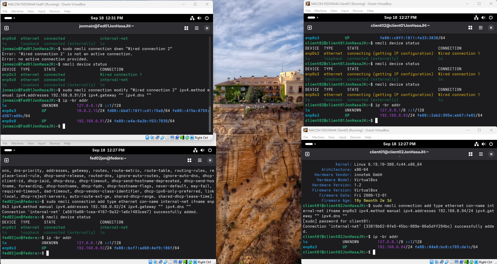
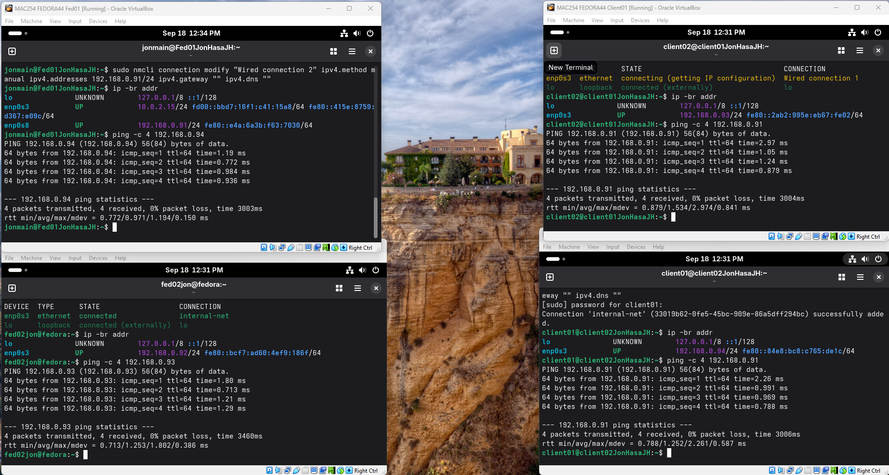
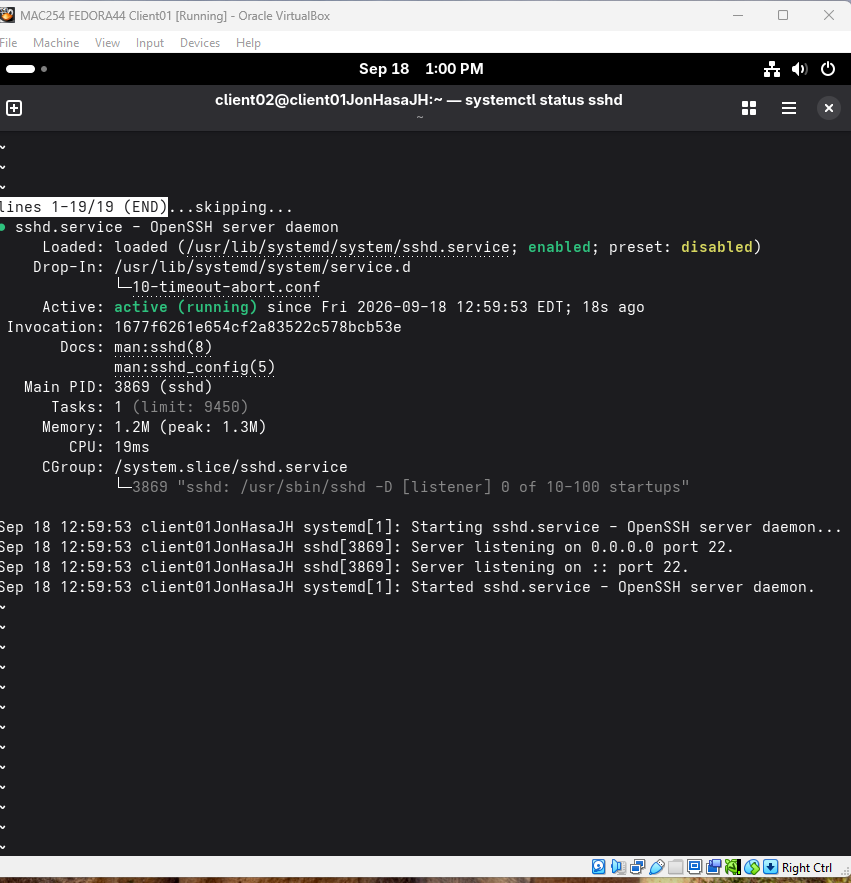
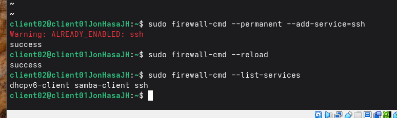
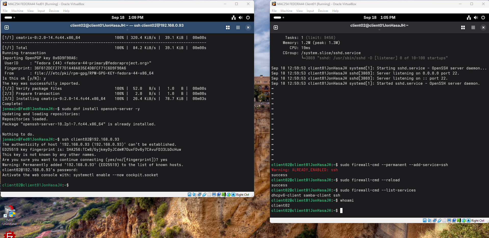
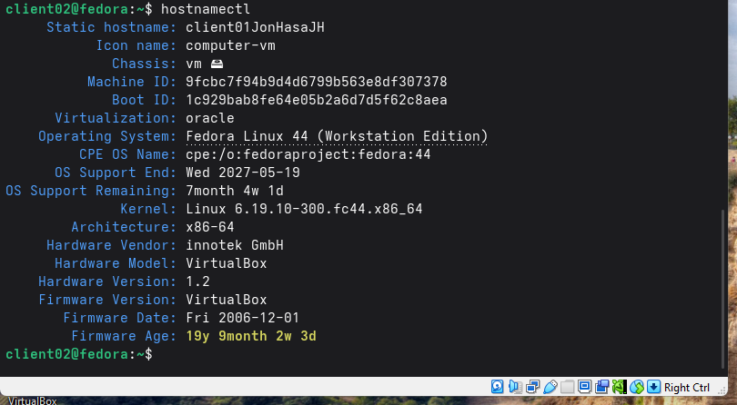
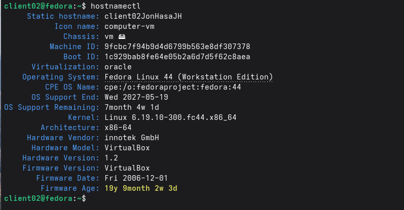

# Fedora Networking and SSH Lab

By **NGGAPLZ**. A four-VM Fedora lab demonstrating hostname verification, static
IPv4 configuration, connectivity checks, SSH service management and firewall rules.
The screenshots are from the original coursework. This preparation reviewed the
evidence but did not start the virtual machines or repeat the connections.

## Lab network

| VM label | Internal IPv4 address | Role |
|---|---|---|
| Fed01 | 192.168.0.91/24 | Main system and SSH client |
| Fed02 | 192.168.0.92/24 | Peer |
| Client01 | 192.168.0.93/24 | SSH target in the demonstrated login |
| Client02 | 192.168.0.94/24 | Peer |

Fed01 also shows a separate 10.0.2.15/24 adapter. The internal lab network uses
192.168.0.0/24. The screenshots show client **account names** that differ from
their VM labels; those labels should not be mistaken for usernames.

## Addressing and connectivity

`hostnamectl` was used to inspect machine names. `nmcli device status` and
`ip -br addr` were used to inspect interfaces and assigned addresses.
The setup screenshot also includes an unsuccessful attempt to disable an inactive
connection profile; the profile name must match the actual configured connection.



The ping evidence shows four transmitted/four received packets on each displayed
path: Fed01 to Client02, Fed02 to Client01, Client01 to Fed01, and Client02 to
Fed01. This supports connectivity on those paths, not an exhaustive all-pairs test.



## SSH and the firewall

The report records `sshd` running and SSH allowed through the firewall.
The relevant commands visible in the evidence include:

```sh
systemctl status sshd
sudo firewall-cmd --permanent --add-service=ssh
sudo firewall-cmd --reload
sudo firewall-cmd --list-services
```

The firewall output reports SSH was already enabled, then successfully reloads
and lists the allowed service. It is evidence of the rule's state, not proof that
this command created a previously absent rule.




The final screenshot shows a successful password-authenticated SSH login from
Fed01 to 192.168.0.93. The password itself is not visible.



For a repeat in your own isolated lab, use an existing account on the target VM
and verify its SSH host-key fingerprint before accepting a first connection.
No credentials or VM images are distributed here.

## Hostname evidence




Original local usernames and machine names remain inside screenshots with the
owner's approval. Editable text and filenames use neutral names.

## Additional shell practice

See [shell practice notes](docs/shell-practice.md) for a compact companion to the
separate screenshot-only exercise. It is supporting practice rather than another
standalone portfolio repository.

## What this demonstrates

Separating VM labels, user accounts, connection profiles and network interfaces
helps avoid configuration mistakes. Checking service state, firewall state and
an actual remote prompt provides stronger evidence than showing configuration
commands alone. Persistent service enablement and SSH key authentication were
not established by the supplied screenshots.

No license has been selected. The original office file and its author metadata
are intentionally omitted from this public package.
